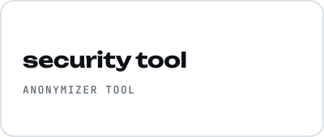
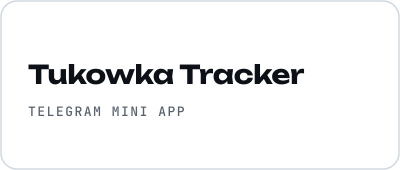

<picture>
  <source media="(prefers-color-scheme: dark)" srcset="assets/nick-dark.svg">
  
</picture>

  <a href="https://github.com/attent10nc/YMusicMod"><picture>
    <source media="(prefers-color-scheme: dark)" srcset="assets/tile-ymusicmod-dark.svg">
    
  </picture></a>
  <a href="https://github.com/attent10nc/security-tool"><picture>
    <source media="(prefers-color-scheme: dark)" srcset="assets/tile-security-dark.svg">
    
  </picture></a>
  <a href="https://t.me/trakertuk_bot"><picture>
    <source media="(prefers-color-scheme: dark)" srcset="assets/tile-tracker-dark.svg">
    
  </picture></a>

 

<picture>
  <source media="(prefers-color-scheme: dark)" srcset="assets/section-stack-dark.svg">
  
</picture>

<picture>
  <source media="(prefers-color-scheme: dark)" srcset="assets/stack-dark.svg">
  
</picture>

  

<picture>
  <source media="(prefers-color-scheme: dark)" srcset="https://raw.githubusercontent.com/attent10nc/attent10nc/output/snake-dark.svg">
  
</picture>

  

