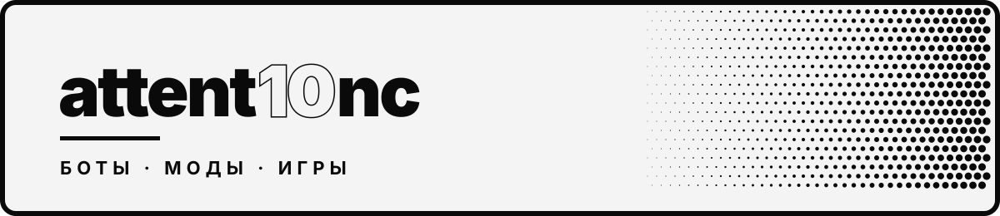

  

  
  
  

### Привет 👋

Делаю софт, который хочется поставить себе: моды для десктопных приложений, Telegram-ботов и мини-аппы, игры в Roblox, инструменты для Dota 2.
Довожу до релиза: установщик в один клик, автосборка в CI, обновления без ручной возни.

- 🎧 Сейчас развиваю **YMusicMod**, кастомизацию Яндекс Музыки для Windows
- 🎮 Веду живую игру в Roblox, **SMILE: CHAOS TYCOON**
- 🤖 Пишу Telegram-ботов на aiogram, от простых рассылок до Mini App с бэкендом на Django
- 🛠 Интересно всё, где нужно залезть внутрь чужого приложения и аккуратно его улучшить

---

## ⭐ YMusicMod

  
  
  

Видео-обои, цвет интерфейса из обложки, визуализатор под бит, мини-плеер поверх игр и статус в Discord.
Ставится одним `Setup.exe` и сам возвращается после обновлений Яндекс Музыки.

**Под капотом:** патч `app.asar` без привязки к версии приложения, свой протокол для мини-плеера, перехват аудио через `captureStream()` для анализа спектра, установщик на C# с фоновым сторожем обновлений, сборка exe в GitHub Actions.

[**Скачать**](https://github.com/attent10nc/YMusicMod/releases/latest) · [Сайт проекта](https://attent10nc.github.io/YMusicMod/) · [Исходники](https://github.com/attent10nc/YMusicMod)

---

## 🧩 Другие проекты

<table>
  <tr>
    <td width="50%" valign="top">
      <h3>😁 SMILE: CHAOS TYCOON</h3>
      
Тайкун в Roblox с бэкрумс-районами, бейджами, геймпассами и рефералками. Переведён на 13 языков, открыт для всех.

      

        
        
      

      <a href="https://www.roblox.com/games/123213847310833"><b>Играть →</b></a>
    </td>
    <td width="50%" valign="top">
      <h3>📊 Tukowka Tracker</h3>
      
Telegram Mini App для разбора матчей Dota 2: статистика, графики, советы по игре. Бэкенд, фронт и бот покрыты тестами (260+).

      

        
        
        
      

      <i>Приватный репозиторий</i>
    </td>
  </tr>
  <tr>
    <td width="50%" valign="top">
      <h3>📡 ThreatRadar</h3>
      
Мониторинг сетевых угроз: захват пакетов, оценка рисков и дашборд с картой сети.

      

        
        
        
      

      <a href="https://github.com/attent10nc/ThreatRadar"><b>Репозиторий →</b></a>
    </td>
    <td width="50%" valign="top">
      <h3>🔎 Network Audit Tool</h3>
      
Обёртка над Nmap: шесть режимов сканирования, понятные отчёты, интерфейс на русском и английском.

      

        
        
      

      <a href="https://github.com/attent10nc/network-audit-tool"><b>Репозиторий →</b></a>
    </td>
  </tr>
</table>

---

## 🛠 Стек

  
  
  
  
  

  
  
  
  
  

  
  
  
  

---

  <picture>
    <source media="(prefers-color-scheme: dark)" srcset="https://raw.githubusercontent.com/attent10nc/attent10nc/output/snake-dark.svg">
    <source media="(prefers-color-scheme: light)" srcset="https://raw.githubusercontent.com/attent10nc/attent10nc/output/snake.svg">
    
  </picture>

