<picture>
  <source media="(prefers-color-scheme: dark)" srcset="assets/hero-dark.svg">
  
</picture>

 

<picture>
  <source media="(prefers-color-scheme: dark)" srcset="assets/label-flagship-dark.svg">
  
</picture>

**YMusicMod**: кастомизация Яндекс Музыки для Windows. Видео-обои, цвет из обложки, визуализатор, мини-плеер поверх игр, статус в Discord. Ставится одним `Setup.exe` и переживает обновления.

[**Скачать**](https://github.com/attent10nc/YMusicMod/releases/latest) &nbsp;·&nbsp; [Сайт](https://attent10nc.github.io/YMusicMod/) &nbsp;·&nbsp; [Исходники](https://github.com/attent10nc/YMusicMod)

 

<picture>
  <source media="(prefers-color-scheme: dark)" srcset="assets/label-projects-dark.svg">
  
</picture>

  <a href="https://github.com/attent10nc/security-tool"><picture>
    <source media="(prefers-color-scheme: dark)" srcset="assets/card-security-dark.svg">
    
  </picture></a>
  <a href="https://t.me/trakertuk_bot"><picture>
    <source media="(prefers-color-scheme: dark)" srcset="assets/card-tracker-dark.svg">
    
  </picture></a>

 

<picture>
  <source media="(prefers-color-scheme: dark)" srcset="assets/label-stack-dark.svg">
  
</picture>

<picture>
  <source media="(prefers-color-scheme: dark)" srcset="assets/stack-dark.svg">
  
</picture>

  

<picture>
  <source media="(prefers-color-scheme: dark)" srcset="https://raw.githubusercontent.com/attent10nc/attent10nc/output/snake-dark.svg">
  
</picture>

  

