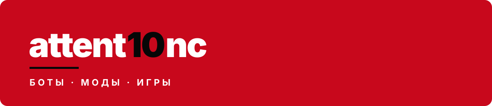

  

  
  

  
  
  

Кастомизация Яндекс Музыки для Windows: видео-обои, цвет из обложки, визуализатор, мини-плеер поверх игр, статус в Discord. Ставится одним `Setup.exe`, переживает обновления.

[**Скачать**](https://github.com/attent10nc/YMusicMod/releases/latest) · [Сайт](https://attent10nc.github.io/YMusicMod/) · [Исходники](https://github.com/attent10nc/YMusicMod)

<table>
  <tr>
    <td width="33%" valign="top">
      <h3>Tukowka Tracker</h3>
      
Telegram Mini App для разбора матчей Dota 2.

      

        
        
        
      

      <a href="https://t.me/trakertuk_bot"><b>→ @trakertuk_bot</b></a>
    </td>
    <td width="33%" valign="top">
      <h3>ThreatRadar</h3>
      
Мониторинг сетевых угроз и дашборд с картой сети.

      

        
        
        
      

      <a href="https://github.com/attent10nc/ThreatRadar"><b>→ репозиторий</b></a>
    </td>
    <td width="33%" valign="top">
      <h3>Network Audit Tool</h3>
      
Обёртка над Nmap: шесть режимов сканирования и отчёты.

      

        
        
      

      <a href="https://github.com/attent10nc/network-audit-tool"><b>→ репозиторий</b></a>
    </td>
  </tr>
</table>

  
  
  
  
  
   
  
  
  
  
  
   
  
  
  

  <picture>
    <source media="(prefers-color-scheme: dark)" srcset="https://raw.githubusercontent.com/attent10nc/attent10nc/output/snake-dark.svg">
    <source media="(prefers-color-scheme: light)" srcset="https://raw.githubusercontent.com/attent10nc/attent10nc/output/snake.svg">
    
  </picture>

